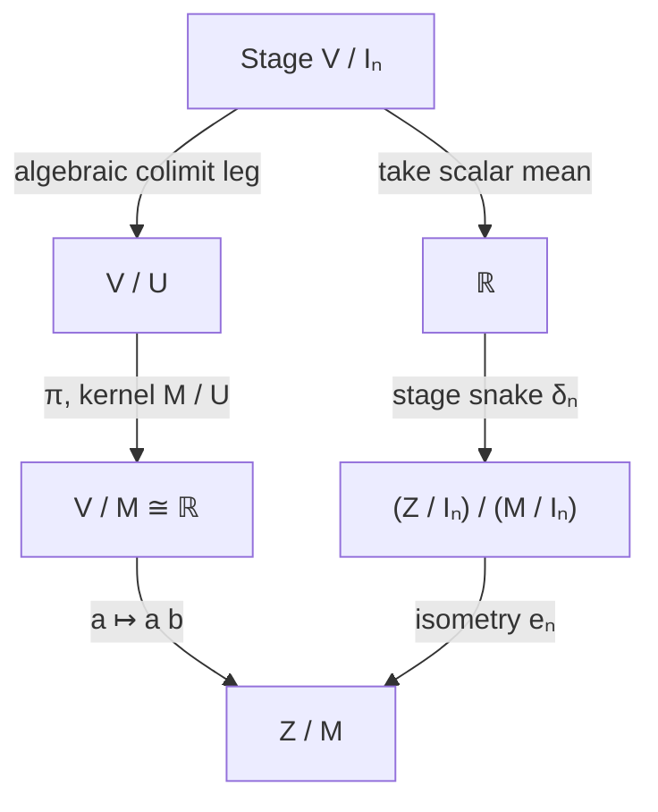

# The support colimit and the ambient snake boundary

The Hausdorff comparison kills the mixed classes $M/U$ in the ordinary algebra colimit $V/U$. The snake target is already the separated space $Z/M$ at **every** denominator. Its unit class has norm $\|u-\mathbf1\|_P$ before and after separation. Boundary vanishing, and hence an unconditional proof of RH by this route, still requires an estimate on one ambient vector.

Here $H=L^2(P;\mathbb R)$, $P(j)=1/[j(j+1)]$ for $j\ge1$, $V$ is the closed legal packet space, and $C(x)=\langle x,\mathbf1\rangle_P$. Write $Z=\ker C$, $M=V\cap Z$, $T(x)=x-C(x)\mathbf1$, $u=(I-P_M)J_2/\log 2$, and $d=u-\mathbf1$. The screened splitting gives $C(u)=1$, $V=M\oplus^\perp\mathbb Ru$, and $d\in Z\cap M^\perp$. The boundary target is $Z/M$. [Centered mean snake](RH/CenteredMeanSnake.lean)

## The towers and their universal properties

Let $I_n\subset M$ be the closed span of the mixed packets $J_q$ with $2\le\omega(q)\le n$, where $\omega(q)$ counts distinct prime factors. Identify $I_n$ with its images in $Z,V,H$, and set $U=\bigcup_n I_n$. Every cutoff $n\ge2$ allows infinitely many conductors. A finite conductor dictionary instead bounds the conductors themselves.

| Diagram | Arrows and vertex | Lean declarations |
|---|---|---|
| Nested conductor rings in commutative rings | The maps $\mathbb Z/m_j\to\mathbb Z/m_i$ reduce residues for $i\le j$ and $m_i\mid m_j$. The inverse limit consists of compatible residue families. | `conductorTowerIsLimit`, `lcmConductorTowerIsLimit`, `primorialConductorTowerIsLimit` |
| Legal quotients in real algebras | The maps $V/I_n\to V/I_k$ for $n\le k$ are surjective with kernel $I_k/I_n$. The colimit for arbitrary algebra maps is $V/U$. | `supportTransition_shortExact`, `supportTransition_kernel_mk_iff`, `algebraicSupportIsColimit` |
| Legal quotients with continuous maps to a Hausdorff real algebra | A compatible cocone factors uniquely and continuously through $V/M\simeq_{\mathbb R\text{-alg}}\mathbb R$. Continuity of the stage-zero leg suffices. | `supportAlgebra_hausdorff_desc`, `quotientEquiv`, `quotientHomeomorph` |
| Ambient quotients in Hausdorff real topological modules | The colimit of $H/I_n$ under forward quotient maps is $H/M$. At this vertex, $0\to Z/M\hookrightarrow H/M\to\mathbb R\to0$ splits by $a\mapsto[a\mathbf1]_M$. | `hausdorffSupportIsColimit`, `boundaryToMixedQuotient_injective`, `exact_boundaryToMixedQuotient_ambientQuotientMean`, `ambientQuotientMean_comp_section` |

The conductor inverse limit specifies compatible residues. Using those residues to approximate a vector in $H$ also requires an estimate in the Pareto norm.

The support stages increase strictly from $n=1$. Their union is dense in $M$. If it exhausted $M$ algebraically, Baire's theorem would give a proper closed linear stage with nonempty interior in the complete space $M$. Thus $U\subsetneq M$ and $\overline U=M$. An element of $M\setminus U$ gives a nonzero class at every support stage and in the algebraic colimit, and maps to zero after separation. The canonical map $\pi$ gives the short exact sequence of real vector spaces

$$
0\longrightarrow K=M/U\longrightarrow V/U
 \xrightarrow{\ \pi\ }V/M\longrightarrow0,\qquad
K=\overline{\{0\}}^{\,V/U}\ne0 .
$$

Here $\pi$ is the comparison induced by the algebraic colimit. A continuous map to a Hausdorff target kills $K$ because its kernel is closed. Quotienting by $K$ gives the Hausdorff reflection. The legal scalar line carries the quotient norm $\|[au]_M\|=\lvert a\rvert\,\|u\|_P$. Both this line and the ambient Hilbert quotient $H/M$ are complete, so separation already produces the completed vertices. [Algebraic comparison and Baire argument](RH/AlgebraicSupportColimit.lean) · [Hausdorff ambient colimit](RH/HausdorffSupportColimit.lean) · [Conductor inverse limits](RH/ConductorTowerLimit.lean)

## The connecting map on every denominator

For **any** real subspace $S\subseteq M$, use its image in each term. The following rows are split short exact sequences of real modules.

$$
\begin{array}{ccccccccc}
0&\to&M/S&\to&V/S&\xrightarrow{C}&\mathbb R&\to&0\\
 &&\downarrow\iota_S&&\downarrow T_S&&\downarrow 0\\
0&\to&Z/S&\to&H/S&\xrightarrow{C}&\mathbb R&\to&0 .
\end{array}
$$

The right vertical arrow is zero because $C(Tv)=0$. The two row sections are $a\mapsto[au]_S$ and $a\mapsto[a\mathbf1]_S$. Lift $a$ by $au$ in the upper row, center it in the middle column, then take its class modulo the image of the left column. This computes the actual snake map.

$$
\delta_S(a)=\big[[ad]_S\big]_{M/S},\qquad
e_S:(Z/S)/(M/S)\ \simeq_{\mathrm{lin.\,isom.}}\ Z/M,\qquad
e_S\delta_S(a)=\partial(a)=a[d]_M .
$$

Here $e_S$ is a surjective linear isometry for the quotient seminorms. For $S\subseteq S'\subseteq M$ the representative-preserving target transition is $p_{S,S'}=e_{S'}^{-1}e_S$. Consequently $p_{S,S'}\delta_S=\delta_{S'}$ and

$$
\|\delta_S(a)\|=|a|\,\|d\|_P .
$$

The same statements apply to $I_n\subseteq I_k$, $I_n\subseteq U$, and $U\subseteq M$. Algebraic row exactness and the calculation of $\delta_S$ hold even for nonclosed $S$. At $S=U$, the intermediate quotient $Z/U$ has $\overline{\{0\}}^{\,Z/U}=M/U$. The second quotient in the snake target already divides by exactly this subspace. [Stage connecting maps and isometries](RH/CenteredMeanStageSnake.lean) · [Module snake lemma, Stacks Project, Tag 07JV](https://stacks.math.columbia.edu/tag/07JV)

The kernel of $T_S$ identifies with $L=V\cap\mathbb R\mathbf1$. Its cokernel identifies with $H/T(V)$. Under these identifications the four interior arrows agree with those in the ambient exact sequence.

$$
0\longrightarrow L\xrightarrow{C}\mathbb R
 \xrightarrow{\partial} Z/M
 \xrightarrow{[z]_M\mapsto[z]_{T(V)}} H/T(V)
 \xrightarrow{\bar C}\mathbb R\longrightarrow0 .
$$

The range $T(V)=M\oplus^\perp\mathbb R d$ is closed. The full long exact sequence is proved in real modules. The row morphisms, their sections and retractions, and the connecting map commute with changes of denominator. Compatibility of the upper section with the **vertical** zero map at $S=M$ would require $[d]_M=0$. Horizontal naturality of the splittings supplies exactly their compatibility along the tower. The separate snake comparing successive support *layers* gives the identity on $I_{k+1}\cap I_k^\perp$ for inclusion and zero for the truncated middle map. Both computations concern that layer diagram. [Long exact sequence](RH/CenteredMeanLongExact.lean) · [Closed centering range](RH/CenteredMeanAmbientGeometry.lean) · [Layer comparisons](RH/MixedConductorSupportSnake.lean)

## The comparison kernel and the missing scalar

Write $b=[d]_M$. The algebraic pullback of the scalar boundary is the continuous real-linear map $B=\mathrm{quotientBoundary}\circ\pi:V/U\to Z/M$. For $q=[v]_U$,

$$
B(q)=C(v)b,\qquad B([u]_U)=b,\qquad \pi([u]_U)=1\ \text{in }V/M\simeq\mathbb R.
$$

It agrees with `stageMeanBoundary` along every colimit leg. The comparison kernel is always contained in $\ker B$. Scalar multiplication on the real vector space $Z/M$ gives

$$
B(q)=0\ \Longleftrightarrow\ \pi(q)=0\ \lor\ \partial=0,\qquad
K\subsetneq\ker B\ \Longleftrightarrow\ \partial=0 .
$$

Indeed, a class in $\ker B$ with nonzero scalar image forces $b=0$ by division by that scalar. Conversely, if $b=0$, the unit is such a witness. The Baire witness lies *inside* $K$. It gives zero scalar and zero boundary for either value of $b$. In the nonzero-boundary case $\ker B=K$ and $\operatorname{im}B=\mathbb Rb$. The diagram below records the map dependencies.

Both paths send $[v]_{I_n}$ to $C(v)b$. At the ambient vertex the natural injection $Z/M\hookrightarrow H/M$ sends $b$ to $[d]_M$. Under the bounded linear equivalence $Z/M\simeq H/V$, the same element becomes $-[\mathbf1]_V$. The condition $b=0$ says exactly $d\in M=\overline U$. Since $d\perp M$, $\|b\|=\|d\|_P$. In particular the one-generator conditions $b=0$, $u=\mathbf1$, and $\mathbf1\in V$ are equivalent. [Comparison on the algebraic colimit](RH/AlgebraicSupportColimit.lean) · [Transport to the legal quotient](RH/CenteredMeanQuotients.lean)

## The two actions and the three section questions

Write $v=m+au$ and $w=n+cu$ with $m,n\in M$. The screened product is $v\star w=ac\,u+an+cm$. Its unit is $u$, and $M^2=0$. Both continuous actions on the physical vector $m$ satisfy $v\star m=m\star v=C(v)m$. They commute and descend along the support quotients to the scalar actions of $V/M$. Their annihilator in $V$ is $M$.

| Category and map | Section |
|---|---|
| Continuous real-linear sections of $C:V\to\mathbb R$ | Each sends $a$ to $a(u+m)$ for a unique $m\in M$. The screened section minimizes the norm. Existence of a section of norm at most one is equivalent to $u=\mathbf1$. |
| Unital real-algebra section of the screened mean | The scalar embedding $a\mapsto au$ is the real-algebra section. Unitality fixes the image of $1$. Composing with $V/M\simeq\mathbb R$ gives a section of the legal quotient projection in real algebras. |
| Regular $V$-module section of $V\to V/M$ | None exists. For every $V$-linear $s:V/M\to V$ and $m\in M$, $m\star s(q)=s(mq)=0$. The annihilator identity forces $s(q)\in M$, so its projection is zero. |

For the first row $\|u+m\|^2=\|u\|^2+\|m\|^2$ and $\|u\|^2=1+\|d\|^2$. The bound of one therefore requires $d=0$. Products with a mixed factor only see $C(v)$. Requiring the inclusion to preserve the screened and ambient products on the two pure packets $J_2,J_3$ is already equivalent to $u=\mathbf1$. [Square-zero product](RH/MixedConductorSquareZero.lean) · [Regular-module obstruction](RH/MixedConductorBimodule.lean) · [Product and norm criteria](RH/CenteredMeanRHCriteria.lean)

## One additional mathematical input

In the diagram the smallest possible witness is **one** $q\in\ker B$ with $\pi(q)\ne0$. To seek such a witness without assuming anything about $u$, the following equivalent test uses only finite Gram data. Let $G_n$ be the Pareto Gram matrix of $J_2,\ldots,J_{n+1}$, let $\lambda=(\Lambda(j))_{j=2}^{n+1}$ and $\mu=(\mu_{\mathrm{Möbius}}(j))_{j=2}^{n+1}$, and set $c_n=G_n^{-1}\lambda$. The matrix has finite dimension and uses the full Pareto inner products, including their tails. The open estimate is

$$
\forall\varepsilon>0\ \forall N\ \exists n\ge N,\qquad
-\mu^\top c_n+(2-\sqrt2)(1-\lambda^\top c_n)\ \ge\ 1-\varepsilon .
$$

`stageUnit_zero_iff_cofinal_gram_solve` identifies this condition with a zero unit boundary at any specified support stage. `riemannHypothesis_of_approximate_first_site_solves` proves the forward implication to Mathlib's `RiemannHypothesis`. The reverse analytic implication in `stageUnit_zero_iff_riemannHypothesis` takes `RiemannHypothesis → BaezDuarte.NaturalApproximation` as an explicit hypothesis.

For a fixed stage $s$, write $B_s$ for the map from $V/I_s$ to $Z/M$. The proof dependencies are

$$
\begin{aligned}
\text{cofinal finite Gram bound}
 &\ \Longleftrightarrow\ B_s(1)=0
 \ \Longleftrightarrow\ b=0
 \ \Longleftrightarrow\ K\subsetneq\ker B,\\
b=0
 &\ \Longleftrightarrow\ u=\mathbf1
 \ \Longleftrightarrow\ \mathbf1\in V
 \ \Longrightarrow\ \mathrm{RH}.
\end{aligned}
$$

The exact error identity explains the cofinal quantifier. Put $g=J_2/\log 2$, $m=P_Mg$, and $Q_n=\|[g-\mathbf1]_{I_n}\|^2$. Orthogonality gives

$$
Q_n=\|\partial\|^2+\|m-P_{I_n}m\|^2,\qquad
Q_n\longrightarrow\|\partial\|^2=\|u-\mathbf1\|^2 .
$$

Density supplies convergence of the second term to zero. An upper bound $Q_n<\varepsilon$ at some stage for every $\varepsilon>0$ controls the first term. The checked bound $Q_2<(11/15)Q_1$ concerns one block. A fixed-factor contraction at arbitrarily late starting stages would suffice. [Finite Gram equivalence](RH/CenteredMeanFiniteDescent.lean) · [Parity quotient identity](RH/PrimeSupportParityQuotient.lean) · [Block contraction criterion](RH/PrimeSupportParityDescent.lean)

## Lean declarations behind the diagram

Names in the first three rows below are in `CenteredMeanSnake.Stage`. The colimit declarations are in `MixedConductorBasis`, under the common prefix `RiemannResearch.RH.Pareto.PrimePowerSchur`.

| Mathematical statement | Declaration |
|---|---|
| $e_S:(Z/S)/(M/S)\simeq_{\mathrm{isom.}} Z/M$ and $p_{S,T}(x)=e_T^{-1}(e_S x)$ | `targetIsometryEquiv`, `targetTransition_eq_isometric_transport` |
| $e_S\delta_S(a)=\partial(a)$ and $\|\delta_S(a)\|=\lvert a\rvert\,\|u-\mathbf1\|$ | `targetEquiv_connecting`, `norm_connecting` |
| $\overline{\{0\}}^{\,Z/U}=M/U$ and the full sequence commutes with passage to the ambient one | `mixedImage_supportUnion_eq_closure_zero`, `longSequence_exact`, `longSequence_comparison` |
| $\ker\pi=\overline{\{0\}}^{\,V/U}=M/U\ne0$ | `supportSeparation_kernel_eq_closure_zero`, `supportSeparation_ker_eq_mixed_image`, `supportIdeal_comparison_not_injective` |
| $B:V/U\to Z/M$ is continuous and pulls back to the stage boundary | `algebraicSupportBoundary`, `algebraicSupportBoundary_continuous`, `algebraicSupportBoundary_stage` |
| $B(q)=0\iff\pi(q)=0\lor\partial=0$ and $\ker\pi<\ker B\iff\partial=0$ | `algebraicSupportBoundary_eq_zero_iff`, `supportSeparation_ker_lt_boundary_ker_iff` |

A transitive axiom check covered all nine added declarations and six inputs, including the existing implication from the cofinal Gram bound to RH. The check allowed only `propext`, `Classical.choice`, and `Quot.sound`. The Gram estimate remains a hypothesis in that implication. [Axiom verification](https://app.buildbuddy.io/invocation/cc8a0e75-d31e-44d7-8cb3-f2a10184ce99)

The reconstruction and the bimodule were audited at their original revisions. [Categorical reconstruction](https://github.com/Cnoack3/RiemannResearch/commit/f98bb5d0c40bb8b9d6ebd2232af13513c798e5ea) · [Bimodule reconstruction](https://github.com/Cnoack3/RiemannResearch/commit/b9f2aac3f1c346f46153e13d155f1a9288037243)
